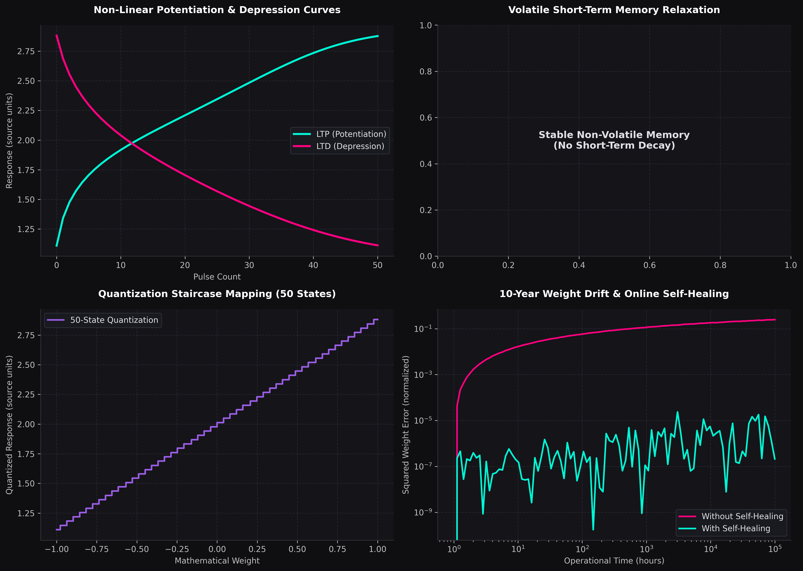

# Bionic Device Physical Datasheet: XJTU_Measured_Memristor
**Device Type**: `MEMRISTOR` | **Memory Category**: `Non-Volatile`
**Generated**: 2026-11-09

**Source File**: `LTP-LTD.xlsx` | **Measured Devices**: 12
**Source Signal**: current | **Unit**: not specified in source

## 1. Core Physical Parameters

| Parameter | Physical Value | Description |
| :--- | :--- | :--- |
| **Current Response Min ($I_{min}$)** | 1.1102e+00 | Minimum measured source response |
| **Current Response Max ($I_{max}$)** | 2.8803e+00 | Maximum measured source response |
| **Device Noise Ratio** | 0.28% | Measured D2D CV at the final LTP pulse |
| **Discrete States Count** | 50 | Number of normalized response levels |
| **Volatility Decay ($\tau$)** | Infinite | Dynamic relaxation time constant |

## 2. Non-Linearity Coefficients (LTP/LTD Slope Polynomials)
The fitted variable $r$ is the min-max normalized source response; coefficients describe normalized updates, not absolute conductance derivatives.
$$\Delta r_{LTP} = -0.3790 \cdot r^3 + 0.7717 \cdot r^2 + -0.5197 \cdot r + 0.1312$$
$$\Delta r_{LTD} = -0.2161 \cdot r^3 + 0.1816 \cdot r^2 + -0.0695 \cdot r + -0.0050$$

## 3. Physical Diagnostic Visualization

---
**Report Generated By**: Organic CIM Simulation & Neuromorphic Computing Platform CLI